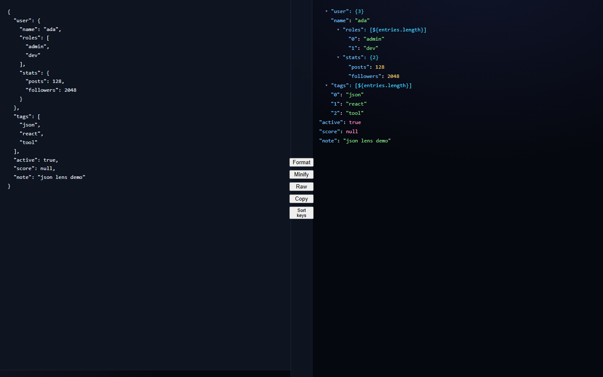
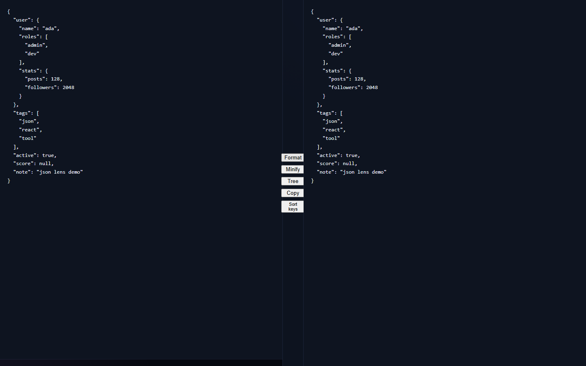
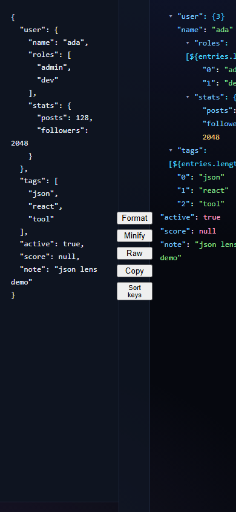

# Relay Tundra — Json Lens

A React-powered JSON workbench: live validation, collapsible tree view, format/minify, key sorting and one-click copy.

<div align="center">


**[Live Demo](https://ruslanfridenli.github.io/relay-tundra/)** · **[Deutsch ↓](#-deutsch)**

</div>

---

## Screenshots







## Features

- Live JSON validation with error reporting
- Collapsible interactive tree view
- Format, minify and sort-keys actions
- Copy to clipboard
- Built with React 19
- English/German interface

## Local development

```bash
git clone https://github.com/ruslanfridenli/relay-tundra.git
cd relay-tundra
# open index.html in a browser, or serve statically:
npx serve .
```

No build step, no dependencies — pure static site.

---

## 🇩🇪 Deutsch

### Relay Tundra — Json Lens

Eine React-JSON-Werkbank: Live-Validierung, einklappbare Baumansicht, Formatieren/Minifizieren, Schlüssel-Sortierung und Kopieren per Klick.

### Funktionen

- Live-JSON-Validierung mit Fehleranzeige
- Einklappbare interaktive Baumansicht
- Formatieren, Minifizieren, Schlüssel sortieren
- In Zwischenablage kopieren
- Mit React 19 gebaut
- Englische/deutsche Oberfläche

### Lokale Entwicklung

```bash
git clone https://github.com/ruslanfridenli/relay-tundra.git
cd relay-tundra
npx serve .
```

Reine statische Seite — kein Build-Schritt, keine Abhängigkeiten.

---

## ☕ Support / Unterstützen

Wenn dir diese Website beim Lernen hilft, würde mir eine Spende sehr viel bedeuten und dabei helfen, sie weiterzuentwickeln. Alternativ kannst du das Projekt mit einem Stern im github repo unterstützen. Vielen Dank!

- Solana: `zQpgZ6nGigww7vYpz3Qqxb1BT44kqS567vFaLTeHagS`
- Ethereum: `0x9c4fE1B2e9a1A9c22312c8296BB088Ca0e8F1B4e`
- Bitcoin: `bc1p2jltk9ya9kyzv35d8kxn7mmg9jqkx66cqtgzqwe75zlr4v9jk4hsv468q7`

---

Made with care. Feedback welcome via issues.
